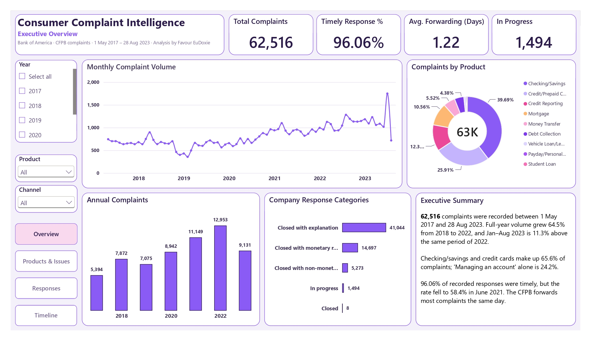

# CFPB-Consumer-Complaint-Analysis
An end-to-end analytics project on **62,516 consumer complaints** about Bank of America submitted to the US Consumer Financial Protection Bureau (CFPB) between **1 May 2017 and 28 Aug 2023**. It covers data validation, cleaning, 12 KPIs cross-checked in Python and SQL, evidence-based insights, and a four-page Power BI dashboard.
> A complaint is a consumer-reported issue. It is not proof of misconduct. A company response category is a recorded classification, not proof of a satisfactory outcome.



## Headline Results
| KPI | Value |
|---|---|
| Total Complaints | **62,516** |
| Full-Year Growth, 2018 → 2022 | **+64.5%** |
| Jan–Aug 2023 vs Jan–Aug 2022 | **+11.34%** |
| Top Product | Checking/Savings: **39.69%** of complaints |
| Top Issue | Managing an Account: **24.17%** |
| Timely Response % | **96.06%** (1,494 pending excluded) |
| Lowest Monthly Timely Rate | **58.35%** (June 2021) |
| CFPB Forwarding Interval | Average **1.22** days, 435 complaints > 30 days |

**Key Insights** (Full detail in [Business Insights](https://github.com/adaeudoxie/CFPB-Consumer-Complaint-Analysis/blob/main/Reports/Business%20Insights%20%26%20Recommendations.md))
1. Volume grew 64.5% in 4 full years and is still rising in 2023.
2. Two products account for two-thirds of complaints. "Managing an account" alone is almost a quarter.
3. Timeliness collapsed in mid-2021, and 2021 holds half of all untimely responses.
5. Referral complaints are 17% of volume but 48% of 30+ day forwarding delays.
6. July 2023 is the highest month on record (+57% vs the Jan–Jun average).
7. 96.5% of complaints carry no substantive public response.

Five linked recommendations in [Business Insights](https://github.com/adaeudoxie/CFPB-Consumer-Complaint-Analysis/blob/main/Reports/Business%20Insights%20%26%20Recommendations.md)

## Dashboard
| Page | Focus |
|---|---|
| [Executive Overview](https://github.com/adaeudoxie/CFPB-Consumer-Complaint-Analysis/blob/main/Dashboard/Executive%20Overview.jpg) | KPIs, monthly trend, product mix, annual volume, responses, summary |
| [Product & Issue](https://github.com/adaeudoxie/CFPB-Consumer-Complaint-Analysis/blob/main/Dashboard/Product%20%26%20Issue%20Analysis.jpg) | Products, top sub-products, top issues, issue × product |
| [Company Response](https://github.com/adaeudoxie/CFPB-Consumer-Complaint-Analysis/blob/main/Dashboard/Company%20Response%20Analysis.jpg) | Response categories, timely/untimely/pending, monthly timeliness, response mix by product, public responses |
| [Complaint Timeline](https://github.com/adaeudoxie/CFPB-Consumer-Complaint-Analysis/blob/main/Dashboard/Complaint%20Timeline%20Analysis.jpg) | Monthly trend, annual YoY (partial years flagged), interval distribution, intervals by product, 30+ day cases |

## Repository structure
```
├── src/                      # reproducible Python pipeline
│   ├── config.py             # paths and constants
│   ├── data_cleaning.py      # raw Excel → cleaned CSV (no rows removed, originals preserved)
│   ├── data_inspection.py    # profiles the raw data
│   ├── validation.py         # 23 automated data checks
│   ├── analysis.py           # 12 KPIs (pandas)
│   ├── run_sql.py            # runs named SQL queries in SQLite
│   └── cross_check.py        # Python vs SQL KPI comparison
├── sql/                      # KPI, insight-evidence and validation queries
├── notebooks/                # complaint_analysis.ipynb (executed walkthrough)
├── reports/                  # data quality · KPI report · business insights · recommendations
├── documentation/            # data dictionary · methodology · dashboard guide · testing report
├── powerbi/                  # dashboard template (.pbit), DAX measures, screenshots
└── run_pipeline.py           # one command: clean → validate → KPIs → SQL → cross-check
```

## Reproduce
The source data is **not committed**. It is the CFPB complaint extract for Bank of America supplied by AnalystLab Africa (`Consumer_Complaints.xlsx`, sheet `Data`, 62,516 rows × 12 columns).
```bash
pip install -r requirements.txt
export COMPLAINTS_RAW=/path/to/Consumer_Complaints.xlsx   # input (read only)
export COMPLAINTS_OUT=/path/to/output_folder              # where complaints_clean.csv is written
python run_pipeline.py      # exits non-zero if any validation or cross-check fails
```
Generated profiles, check results and KPI tables are written to `outputs/` (not committed).

## Method in brief
1. **Inspect and clean:** label, derive and flag, never delete. 22 derived columns ([data_quality_report](reports/data_quality_report.md)).
2. **Validate:** 23 Python and 9 SQL checks, plus negative tests ([data_quality_report §6](reports/data_quality_report.md#6-validation-results)).
3. **Calculate:** 12 KPIs in Python and independently in SQL. 16/16 tables identical ([kpi_report](reports/kpi_report.md)).
4. **Visualise:** Power BI model with 19 DAX measures, validated by DAX query against the Python/SQL outputs ([testing_report](documentation/testing_report.md)).

Full methodology: [`documentation/methodology.md`](documentation/methodology.md).

## Key interpretation rules
- **Blank "Timely response?" is not "No".** The 1,494 blanks are all *In progress* complaints. They are labelled *Pending* and excluded from the timely % denominator.
- **Date received − Date submitted is the CFPB forwarding interval**, not the company's response or resolution time.
- **2017 (May–Dec) and 2023 (Jan–28 Aug) are partial years.** Year-on-year comparisons use full years or the same Jan–Aug window.

## Limitations
No company response dates, narratives, customer counts or relief amounts, so resolution time, complaint validity and complaint *rates* cannot be measured. See [`documentation/methodology.md`](documentation/methodology.md#6-assumptions-and-limitations).

## Tools
Python (pandas, openpyxl, matplotlib), SQLite, Jupyter, Power BI Desktop (DAX, Power Query), Git/GitHub.

## Data source and attribution
Consumer Financial Protection Bureau (CFPB), Consumer Complaint Database: complaints relating to Bank of America, supplied by AnalystLab Africa for training purposes. This project is not affiliated with the CFPB or Bank of America.

## AI assistance
Claude (Anthropic) was used as an AI assistant for code, documentation and dashboard generation. All outputs were run, validated and reviewed. The revision log is in [`documentation/testing_report.md`](documentation/testing_report.md#7-revision-log).

---
#AnalystLabAfrica
